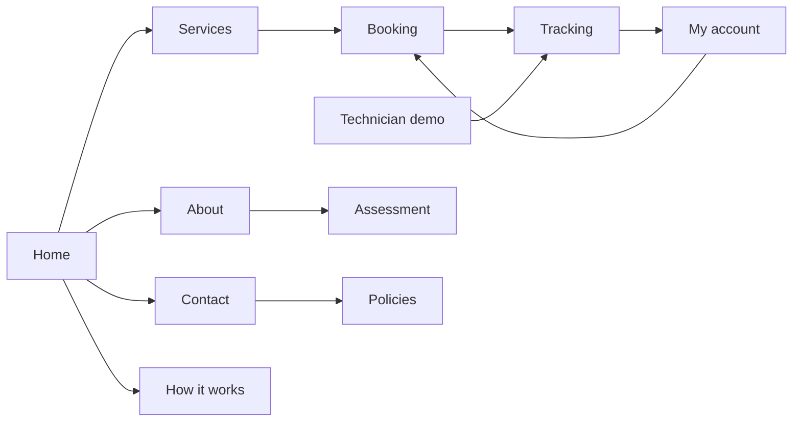
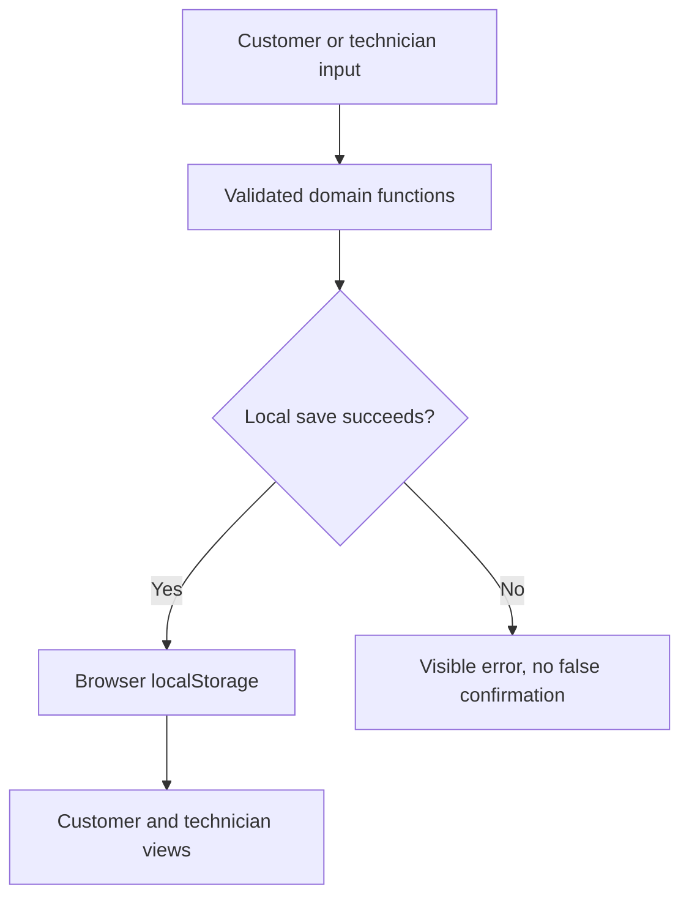

# Design

Ten customer/operational screens: Home, Services, Booking, Tracking, My account, Technician demo, About, Contact, How it works and Policies. Assessment is an additional supporting route. All are hash-routed React screens in one HTML application.

Journey: urgent care need → inspect services → choose care/garments → enter eligible location → select time → review price → consent/demo checkout → saved order → capable technician accepts → travel/arrival/treatment/completion → feedback.

Data: Customer has ID, contact, saved addresses and preference. Technician has ID, display name, availability and capabilities; jobs are derived from orders. Service has price, eligible garment types, availability and estimates. Booking stores a UUID, input snapshots, assigned technician, pricing, timing, current status, created/updated dates, events and feedback.

Rules: one service, integer total quantity 1–6, supported garments, explicit consent, validated location/profile and schedule. Only assigned technicians advance sequential statuses. Closed orders cannot advance twice. Cancellation stops before en route. Immediate pressing/refresh orders of up to three garments alone qualify for the AED 5 late-completion fee waiver.

Navy, cream and sage, Georgia headings, Arial controls and local generated garment imagery preserve the existing brand. Desktop card grids and form/summary columns stack on mobile. Customer pages omit technical sitemap content; the separate Assessment route keeps layouts, block compositions, detailed content analysis and rules available. The downloadable design specification expands these details for all screens.
