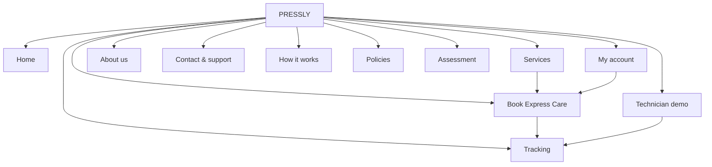
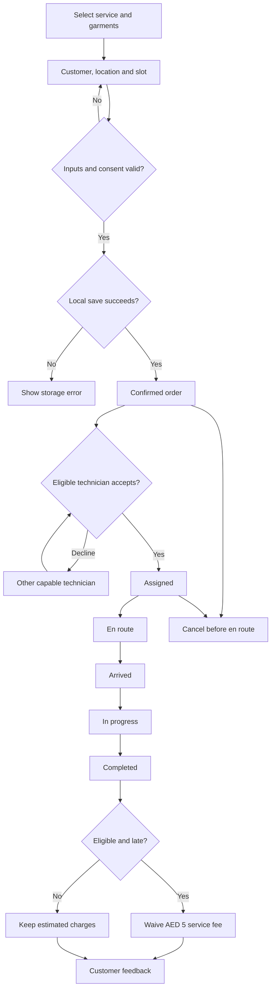
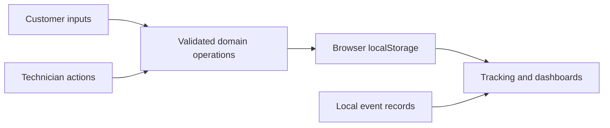

# PRESSLY — Website design specification

Ten customer/operational routes and a separate assessment route in one React application. All services and payment outcomes are demonstrations. No original BUS201 brief was available: confirm the final rubric and word-limit interpretation.

## Sitemap



Shared header, all-pages menu and footer expose the routes. Service actions preselect care; browser back/forward follows hash navigation.

## Home

Purpose: Introduce on-site garment care and convert an urgent need into a demonstration booking.

Content: Hero, services, workflow, use cases, qualified sustainability, fee-waiver policy, illustrative testimonials and FAQs.

Operations: Book express care or open the full how-it-works process.

Desktop block composition:

```text
[Shared header]
[ Headline and booking actions ] [ Wardrobe image ]
[ Three care cards ]
[ Process and use cases ]
[ Technology, guarantee and FAQ ]
[Shared footer]
```

Mobile block composition:

```text
[Logo / booking / menu]
[ Headline and booking actions ]
[ Wardrobe image ]
[ Three care cards ]
[ Process and use cases ]
[ Technology, guarantee and FAQ ]
[Footer]
```

Layout: Blocks stack in reading order on phones; wide tables scroll locally, navigation opens a keyboard-accessible menu and form controls retain readable labels and tap targets.

States: All current services bookable; Rapid Wash is not sold.

## Services

Purpose: Explain suitability, editable demonstration prices and service limits before checkout.

Content: Three available services, dynamic calculator, future Rapid Wash and fixed fabric assessment.

Operations: Choose service and quantity, calculate fees or inspect a fabric and stain.

Desktop block composition:

```text
[Shared header]
[ Service heading ]
[ Three service cards ]
[ Calculator explanation ] [ Inputs and price ]
[ Future washing ] [ Fabric guide ]
[Shared footer]
```

Mobile block composition:

```text
[Logo / booking / menu]
[ Service heading ]
[ Three service cards ]
[ Calculator explanation ]
[ Inputs and price ]
[ Future washing ]
[ Fabric guide ]
[Footer]
```

Layout: Blocks stack in reading order on phones; wide tables scroll locally, navigation opens a keyboard-accessible menu and form controls retain readable labels and tap targets.

States: Invalid quantities show errors; specialist outcomes do not offer on-site treatment.

## Book Express Care

Purpose: Create a validated, uniquely identified and persistent demonstration order.

Content: Six steps: service, garments, customer/location, time, review, checkout.

Operations: Validate inputs, review pricing and consent, save order and open tracking.

Desktop block composition:

```text
[Shared header]
[ Progress indicator ]
[ Step form ] [ Live summary ]
[ Validation and navigation ]
[Shared footer]
```

Mobile block composition:

```text
[Logo / booking / menu]
[ Progress indicator ]
[ Step form ]
[ Live summary ]
[ Validation and navigation ]
[Footer]
```

Layout: Blocks stack in reading order on phones; wide tables scroll locally, navigation opens a keyboard-accessible menu and form controls retain readable labels and tap targets.

States: Loading, invalid inputs, save failure and saved confirmation are explicit.

## Tracking

Purpose: Show the actual saved order status, target times and event history.

Content: Order selector, booking details, six status stages and timestamped events.

Operations: Switch order, cancel before en route, view technician demo and rate completion.

Desktop block composition:

```text
[Shared header]
[ Demo notice and order selector ]
[ Order details and price ]
[ Status stages ]
[ Event history and feedback ]
[Shared footer]
```

Mobile block composition:

```text
[Logo / booking / menu]
[ Demo notice and order selector ]
[ Order details and price ]
[ Status stages ]
[ Event history and feedback ]
[Footer]
```

Layout: Blocks stack in reading order on phones; wide tables scroll locally, navigation opens a keyboard-accessible menu and form controls retain readable labels and tap targets.

States: No orders, active, overdue, completed, cancelled and missing assignment states.

## My account

Purpose: Manage the single-browser customer profile and order history.

Content: Active/completed orders, rebooking, saved addresses, preferences, inquiries and privacy controls.

Operations: Rebook, open tracking, save profile or explicitly delete local demo data.

Desktop block composition:

```text
[Shared header]
[ Demo account notice and totals ]
[ Active orders ] [ History ]
[ Profile and saved addresses ]
[ Support inbox and clear-data action ]
[Shared footer]
```

Mobile block composition:

```text
[Logo / booking / menu]
[ Demo account notice and totals ]
[ Active orders ]
[ History ]
[ Profile and saved addresses ]
[ Support inbox and clear-data action ]
[Footer]
```

Layout: Blocks stack in reading order on phones; wide tables scroll locally, navigation opens a keyboard-accessible menu and form controls retain readable labels and tap targets.

States: Empty histories, save validation, confirmation and storage failures.

## Technician demo

Purpose: Demonstrate capability-based acceptance and service progress.

Content: Role selector, capabilities, assigned jobs, available requests, completions and illustrative earnings.

Operations: Accept or decline a request, advance only an assigned job and inspect tracking.

Desktop block composition:

```text
[Shared header]
[ Role and capabilities ]
[ Assigned jobs ] [ Available requests ]
[ Completed jobs and earnings ]
[Shared footer]
```

Mobile block composition:

```text
[Logo / booking / menu]
[ Role and capabilities ]
[ Assigned jobs ]
[ Available requests ]
[ Completed jobs and earnings ]
[Footer]
```

Layout: Blocks stack in reading order on phones; wide tables scroll locally, navigation opens a keyboard-accessible menu and form controls retain readable labels and tap targets.

States: Busy, unsupported, declined, scheduled-not-started and no-job states.

## About us

Purpose: Explain the startup mission and on-site business model without technical customer clutter.

Content: Mission, values, customer problem, gig model, measured sustainability and future expansion.

Operations: Read the venture story or open the separate assessment page.

Desktop block composition:

```text
[Shared header]
[ Editorial garment image ]
[ Mission ] [ Values ]
[ Operating model and future work ]
[Shared footer]
```

Mobile block composition:

```text
[Logo / booking / menu]
[ Editorial garment image ]
[ Mission ]
[ Values ]
[ Operating model and future work ]
[Footer]
```

Layout: Blocks stack in reading order on phones; wide tables scroll locally, navigation opens a keyboard-accessible menu and form controls retain readable labels and tap targets.

States: Static explanation with explicit prototype limits.

## Contact & support

Purpose: Validate and save a local support request with an honest receipt.

Content: User-supplied project phone contacts, request form, FAQ and policy links.

Operations: Save local inquiry and inspect it in My account; optionally open a phone dialler.

Desktop block composition:

```text
[Shared header]
[ Support and project contacts ] [ Inquiry form ]
[ FAQ ]
[ Policy and booking support links ]
[Shared footer]
```

Mobile block composition:

```text
[Logo / booking / menu]
[ Support and project contacts ]
[ Inquiry form ]
[ FAQ ]
[ Policy and booking support links ]
[Footer]
```

Layout: Blocks stack in reading order on phones; wide tables scroll locally, navigation opens a keyboard-accessible menu and form controls retain readable labels and tap targets.

States: Invalid inputs, saved local receipt and storage failure; no email delivery.

## How it works

Purpose: Explain the customer-to-technician lifecycle visually.

Content: Booking, acceptance, travel, inspection/treatment, completion and feedback.

Operations: Follow the process and start a demonstration booking.

Desktop block composition:

```text
[Shared header]
[ Customer booking ]
[ Technician acceptance and travel ]
[ Assessment, completion and rating ]
[Shared footer]
```

Mobile block composition:

```text
[Logo / booking / menu]
[ Customer booking ]
[ Technician acceptance and travel ]
[ Assessment, completion and rating ]
[Footer]
```

Layout: Blocks stack in reading order on phones; wide tables scroll locally, navigation opens a keyboard-accessible menu and form controls retain readable labels and tap targets.

States: Explains simulation and same-browser demonstration.

## Policies

Purpose: Describe scoped proposed commitments, exclusions and local data handling.

Content: Arrival/completion targets, fee waiver, pricing, cancellation, damage, stains and privacy.

Operations: Read draft conditions and locate support or data-deletion controls.

Desktop block composition:

```text
[Shared header]
[ Draft policy notice ]
[ Timing and guarantee ]
[ Cancellation and treatment limits ]
[ Privacy and future records ]
[Shared footer]
```

Mobile block composition:

```text
[Logo / booking / menu]
[ Draft policy notice ]
[ Timing and guarantee ]
[ Cancellation and treatment limits ]
[ Privacy and future records ]
[Footer]
```

Layout: Blocks stack in reading order on phones; wide tables scroll locally, navigation opens a keyboard-accessible menu and form controls retain readable labels and tap targets.

States: Draft terms, not a commercial legal policy.

## Assessment

Purpose: Present concise BUS201 design and implementation evidence separately from customer content.

Content: Sitemap, layouts, rules, diagrams, business analysis and downloadable specification.

Operations: Expand documentation and download supporting design notes.

Desktop block composition:

```text
[Shared header]
[ Documentation links ]
[ Sitemap and screen compositions ]
[ Rules and process diagrams ]
[ Business analysis ]
[Shared footer]
```

Mobile block composition:

```text
[Logo / booking / menu]
[ Documentation links ]
[ Sitemap and screen compositions ]
[ Rules and process diagrams ]
[ Business analysis ]
[Footer]
```

Layout: Blocks stack in reading order on phones; wide tables scroll locally, navigation opens a keyboard-accessible menu and form controls retain readable labels and tap targets.

States: Native expandable content; no team-member allocation in customer pages.

## Business rules

### BR01: Services

Express Pressing, Steam Refresh and Express Stain Treatment are available; Rapid Wash is unavailable pending validation.

### BR02: Pricing

Express Pressing AED 10 per garment, Steam Refresh AED 5 per garment, and Express Stain Treatment AED 20 per spot. Add AED 5 per booking. No additional tax or delivery surcharge is modelled.

### BR03: Quantity and eligibility

One available service per order, one to six total garments/spots, integer quantities, only listed garment types. Sensitive fabrics and ink route to specialists.

### BR04: Location and slots

Name, valid email, phone, eligible fictional zone, address and building are required. Scheduling is 30 minutes to seven days ahead in device-local time.

### BR05: Consent and persistence

Explicit demo/storage/treatment consent is required. Save must succeed before booking confirmation. Orders and profile are local to the browser origin.

### BR06: Service targets

Arrival target is 30 minutes from immediate confirmation or scheduled start. Pressing/refresh completion target is 60 minutes from start. Stains require assessment, not a fixed deadline.

### BR07: Promotional waiver

Only immediate pressing/refresh orders of up to three eligible garments qualify. Late completion waives the AED 5 service fee; care charges remain. Scheduled, stain and larger bookings are excluded.

### BR08: Assignment and status

An available capable technician accepts one active job at a time. Only that technician advances assigned ? en route ? arrived ? in progress ? completed. No skipping or duplicate completion. Declines leave the request for other technicians.

### BR09: Cancellation and feedback

Customer cancellation is allowed only while confirmed or assigned. Closed orders cannot advance. One rating from one to five and optional comment can be saved after completion.

### BR10: Payments and privacy

Card/cash/Apple Pay are simulations; no real payment details collected. Support requests are validated and stored locally, not sent. Clear demo data deletes profile, orders, feedback and requests. Local event history is not blockchain.

## Layout analysis

### Visual identity

Retained navy, cream, sage, Georgia headings, Arial controls and four local generated editorial images.

### Block compositing

Reusable header and footer wrap route-specific modules. Three service columns and form/summary splits stack on phones.

### Accessibility

One h1 per route, skip target, visible focus, native labels and required fields, status messages, disclosure controls and reduced motion.

### Responsive layout

Fluid containers, one-column phone forms, wrapping status stages and an all-pages menu; long order IDs wrap and comparison tables scroll.

## Implementation

### Implementation

React 19 and Vite, hash routing, pure domain operations, localStorage persistence and same-origin storage-event synchronisation.

### Privacy boundary

One demo account in this browser; no real authentication, cross-device sync, GPS, payment gateway, blockchain or server order database. Use fictional details.

### Data models

Customer: identity/contact/preferences/addresses. Technician: capabilities/availability; assigned jobs are derived. Service: price/eligibility/timing. Booking: UUID, snapshot inputs, assigned actor, pricing, times, status and event history.

### Future architecture

A shared backend, authenticated roles, signed events and verified consent would be needed before cross-device commercial use. Decentralised identity or tamper-evident records remain future options.

### Assessment verification

The original rubric was not found locally. These are route-selected screens in one HTML application. No fabricated surveys, operating results or usability test results.

## Acceptance scenarios

### Booking

Create an immediate order, reload, accept in Technician demo and advance all stages; view the same timeline in Tracking.

### Validation

Reject unavailable services, unsupported garments, fractional quantities, missing consent, invalid profile/location and invalid schedule.

### Integrity

Reject nonassigned technicians, skipped transitions, duplicate completion, cancellation after departure and stale storage revisions.

### Guarantee

Late eligible completion waives only AED 5; scheduled, stain and larger orders remain ineligible.

### Persistence

Successful saves survive reload; corrupt/unavailable storage surfaces a failure and does not silently confirm.

### Usability

Manual keyboard, mobile/tablet/desktop and full browser workflow review must be recorded honestly, separately from automated logic/render tests.

## Customer and technician flow



## Data architecture



The event log is editable, local and not a blockchain. No real dispatch, payments, GPS or cross-device service exists.
